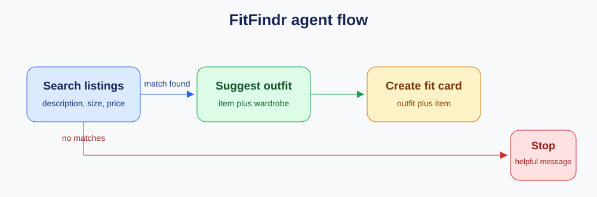
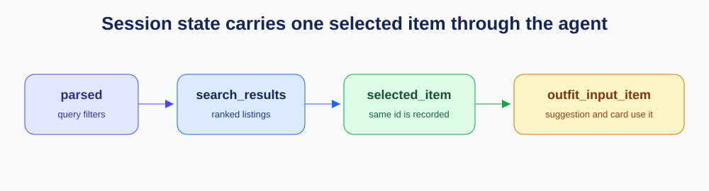
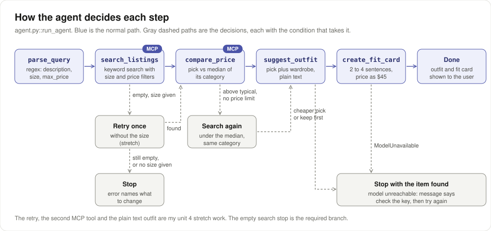

# FitFindr



## What This Does

A user types what they want, for example `90s track jacket in size M` or
`vintage graphic tee under $30`. FitFindr searches the 40 supplied listings,
picks one, checks its price against similar listings, suggests outfits from the
user's wardrobe and writes a short caption with the price and platform. If
nothing matches, it stops and tells the user what to change.

## Tool Inventory

### `search_listings`

- What it does: Keyword search over the listings, with optional size and
  price filters.
- Inputs: `description` (str), `size` (str or None), `max_price`
  (float or None, inclusive).
- Returns: `list[dict]`, at most 10 listing dicts, best keyword match first
  (ties go to the lower price). Each dict has `id`, `title`, `description`,
  `category`, `style_tags`, `size`, `condition`, `price`, `colors`, `brand`,
  `platform`.
- When it has nothing: an empty list `[]`.

Size rule: sizes are matched as tokens, not substrings. `8` matches
`US 8` but not `US 8.5`, `W30` matches `W30 L30`, and `S` matches `S/M` but not
the S in `US 9`.

### `suggest_outfit`

- What it does: Asks the model for one or two outfits built around the
  picked listing.
- Inputs: `new_item` (dict, one listing), `wardrobe` (dict with an
  `items` list).
- Returns: `str`, outfit ideas that name the user's own pieces.
- When it has nothing: with an empty wardrobe it asks for general styling
  ideas instead. If the model returns nothing, it returns a retry message.

### `create_fit_card`

- What it does: Asks the model for a caption someone could post.
- Inputs: `outfit` (str from `suggest_outfit`), `new_item` (dict).
- Returns: `str`, two to four sentences that ask for the title, exact price
  and platform once each.
- When it has nothing: a blank `outfit` returns "I need an outfit
  suggestion before I can make a fit card." without calling the model.

### `compare_price` (stretch)

- What it does: Compares one listing's price with the other listings in the
  same category. No model call.
- Inputs: `new_item` (dict).
- Returns: `dict` with `item_id`, `item_price`, `category`,
  `compared_count`, `median_price`, `lowest_price` and `verdict`. The verdict
  is `above typical` over 1.2 times the median, `below typical` under 0.8
  times, otherwise `typical`.
- When it has nothing: if no other listing shares the category,
  `compared_count` is 0, the prices are None and the verdict is
  `no comparison`.

## Planning Loop

Branch rule: If `search_listings` returns an empty list, put a message in
`session["error"]` that names what to change and stop, without calling
`suggest_outfit`. Otherwise take the first result and go to `compare_price`.

Second branch (stretch): If `compare_price` says the pick is
`above typical` and the user gave no price limit, search again with the
category median as the limit and keep only the same category. If that finds
something, switch to it. Otherwise keep the first pick. Then go to
`suggest_outfit`.

Where it lives: `agent.py::run_agent`

How the query is parsed: regex, in `agent.py::_parse_query`. It pulls out
`size X` and `under $N`, and the rest is the description. I thought a model
call here would cost a request and make the branch harder to test.

What moves through the session: `parsed`, `search_results`,
`selected_item`, `price_check`, `outfit_input_item`, `outfit_suggestion`,
`fit_card`. `error` is set only on an empty search. `original_pick` and
`price_branch` are set only when the second branch runs. Every tool reads its
input back out of the session, and `outfit_input_item` is copied from
`selected_item` so the two ids can be compared in Unit 4.



## Sample Run

Pasted as printed, except the model's markdown stars are removed.

### One full query

```
$ python app.py ask '90s track jacket in size M'

  Found:    90s Track Jacket — Navy/White Stripe — $45.0 on poshmark
  Price:    typical ($45.0 vs a median of $40.0 across 7 other outerwear)

  Outfit:   Here are two effortless ways to style your new Champion track jacket using pieces you already own:

Look 1: Streetwear Casual
Pair the track jacket unzipped over the white ribbed tank top, teamed with your baggy straight-leg jeans (dark wash). Finish the outfit with your chunky white sneakers and the black crossbody bag for an easy, sporty 90s aesthetic. 

Look 2: High-Low Contrast
Layer the track jacket over the white ribbed tank top, but tuck it into your wide-leg khaki trousers secured with the brown leather belt. Ground the look with your chunky white sneakers and carry the black crossbody bag for a clean, street-smart mix of athletic and minimal styles.

  Fit card: Scored this pristine Champion 90s Track Jacket on Poshmark for just $45.0, and it is the ultimate lightweight layer for throwing over a white tank and baggy denim. The navy and white sleeve detailing gives it such an authentic retro athletic feel.

0 model calls this session, 2 served from cache
```

### The empty search

```
$ python app.py ask 'designer ballgown size XXS under $5'

  I couldn't find a listing that fits those details. Try broadening the description, choosing another size, or raising the price limit.

0 model calls this session
```

### The tools, tested one at a time

```
$ python -c "from tools import search_listings; print([(x['id'], x['title'], x['price']) for x in search_listings('graphic tee', max_price=30)])"
[('lst_017', 'Mesh Long-Sleeve Top — Black', 15.0), ('lst_002', 'Y2K Baby Tee — Butterfly Print', 18.0), ('lst_033', 'Vintage Band Tee — Faded Grey', 19.0), ('lst_006', 'Graphic Tee — 2003 Tour Bootleg Style', 24.0), ('lst_012', 'Oversized Crewneck Sweatshirt — Vintage Navy', 20.0), ('lst_015', 'Vintage Graphic Hoodie — Faded Black', 26.0), ('lst_011', 'Low-Rise Cargo Pants — Khaki', 27.0)]
```

```
$ python -c "from tools import search_listings; print(search_listings('designer ballgown', size='XXS', max_price=5))"
[]
```

```
$ python -c "from tools import suggest_outfit; from utils.data_loader import get_example_wardrobe, load_listings; print(suggest_outfit(load_listings()[3], get_example_wardrobe()))"
Here are two effortless ways to style your new Champion track jacket using pieces you already own:

Look 1: Streetwear Casual
Pair the track jacket unzipped over the white ribbed tank top, teamed with your baggy straight-leg jeans (dark wash). Finish the outfit with your chunky white sneakers and the black crossbody bag for an easy, sporty 90s aesthetic. 

Look 2: High-Low Contrast
Layer the track jacket over the white ribbed tank top, but tuck it into your wide-leg khaki trousers secured with the brown leather belt. Ground the look with your chunky white sneakers and carry the black crossbody bag for a clean, street-smart mix of athletic and minimal styles.
```

```
$ python -c "from tools import create_fit_card; from utils.data_loader import load_listings; print(create_fit_card('White ribbed tank top, baggy jeans and chunky white sneakers.', load_listings()[3]))"
Layered this 90s Champion track jacket over a white ribbed tank with baggy denim and chunky sneakers today. Found this lightweight navy and white striped piece in pristine condition for just $45.0 on poshmark. It's the ultimate effortless throw-on piece for transitional weather.
```

```
$ python -c "from tools import compare_price; from utils.data_loader import load_listings; print(compare_price(load_listings()[21]))"
{'item_id': 'lst_022', 'item_price': 75.0, 'category': 'outerwear', 'compared_count': 7, 'median_price': 40.0, 'lowest_price': 27.0, 'verdict': 'above typical'}
```

## Stretch Features

I declared these three before I built them.

1. A fourth tool, `compare_price`. It compares the selected listing's price
   with the other listings in the same category and returns the median, the
   lowest price and a verdict.
2. A second branch. If `compare_price` says the first pick is above typical
   for its category and the user gave no price limit, the loop searches again
   with the category median as the limit and switches to a cheaper result in
   the same category. If there is none, it keeps the first pick.
3. Style memory. With `--remember`, the agent saves each item it picks to a
   local file and adds saved items to the wardrobe on the next run.

### What each one changed

`compare_price`: the agent calls it on every pick. It prints the `Price:` line,
as in the full query above.

Second branch: for `leather jacket` the first pick was a $75 bomber, above
typical, with no price limit. The loop searched again under the $40 median and
switched to a $33 shacket, which is not leather. For `cardigan` nothing cheaper
matched, so it kept the first pick.

```
$ python app.py ask 'leather jacket'
  Found:    Shacket — Olive Canvas — $33.0 on poshmark
  Price:    below typical ($33.0 vs a median of $42.0 across 7 other outerwear)
  Branch:   switched to a cheaper pick (first pick: 90s Leather Bomber — Black, $75.0)
  ...

$ python app.py ask 'cardigan'
  Found:    Knit Cardigan — Chunky Brown — $35.0 on depop
  Price:    above typical ($35.0 vs a median of $20.5 across 14 other tops)
  Branch:   no cheaper match, kept the first pick
  ...
```

Style memory: both runs use an empty wardrobe. Run 1 saves the carpenter
jeans. Run 2 loads them, and both outfits use them. The model also named a
hoodie and boots the wardrobe does not hold.

```
$ python app.py ask 'baggy carpenter jeans' --empty-wardrobe --remember
(style memory: 0 saved item(s) added to the wardrobe)
  Found:    Baggy Carpenter Jeans — Dark Wash — $36.0 on depop
  Outfit:   At $36, these dark wash carpenter jeans are a versatile streetwear staple. ...
  Saved to style memory: Baggy Carpenter Jeans — Dark Wash

$ python app.py ask 'vintage band tee' --empty-wardrobe --remember
(style memory: 1 saved item(s) added to the wardrobe)
  Found:    Vintage Band Tee — Faded Grey — $19.0 on depop
  Outfit:   Outfit 1: Effortless 90s Streetwear
  - Top: Vintage Band Tee (Faded Grey)
  - Bottoms: Baggy Carpenter Jeans (Dark Wash)
  ...
  Outfit 2: Grungy Casual
  - Top: Vintage Band Tee (Faded Grey)
  - Bottoms: Baggy Carpenter Jeans (Dark Wash)
  ...
  Saved to style memory: Vintage Band Tee — Faded Grey
```

These blocks are trimmed to the relevant lines (`...` marks a cut). The
commands reproduce the full output. `python app.py forget` clears the memory
file, `.fitfindr_memory.json`, which git ignores.

## How I Used AI

### Moment 1

What I asked for: Before writing the search tool, I asked Codex to find
size formats in the listings that would break a substring check.

What came back: `S/M`, `M/L`, `W30`, `US 8` and `US 8.5`. A substring
check would match size 8 to `US 8.5` and mix clothing sizes with shoe sizes.

What I changed: I wrote separate rules for clothing ranges, waist sizes
and shoe sizes. Size 8 now returns only the `US 8` sneakers, and `W30` returns
the W30 jeans.

### Moment 2

What I asked for: I asked Codex how a test could prove the item search
picked is the same item `suggest_outfit` received.

What came back: Reading the outfit text cannot prove it, because the model
paraphrases. The session needs a record of the exact input.

What I changed: I added `session["outfit_input_item"]`, copied from
`selected_item` right before the call, so criterion 3 can compare the two ids.

### Moment 3

What I asked for: I asked Claude to build the three stretch features, with
the README declaration committed before any code.

What came back: When I tested the second search without a category
filter, `leather jacket` under $40 returned a leather belt first.

What I changed: The second search keeps only results in the same category
as the first pick, so the switch is from one jacket to another.

### Moment 4 (Unit 4)

What I asked for: I asked Claude to score each try in code instead of by eye,
one check per criterion in `checks.py`.

What came back: all 25 tries passed, so the run log showed nothing to diagnose.
Counting price formats across the fit cards found 12 of 20 with $45.0, which my
criterion 4 check accepts.

What I changed: I added `measure.py` for that count and made the price format
my improvement, measured with it before and after.

# Unit 4: Testing



I drew this to show every decision the loop makes this unit and the
condition that takes it.

## Unit 4 Stretch Features

I declared these three before I built them.

1. A second tool on MCP: `compare_price`, alongside `search_listings`.
2. Retry with looser constraints: when a search with a size comes back empty,
   the loop searches once more without the size and says it dropped the size.
3. A second improvement from my diagnosis, measured with a third run log in
   the same format.

## Run Log: Before

Produced by `run_eval.py::main`, five tries per criterion, cache off. Each try
is scored by `checks.py::check`. Raw file: `results/run_2026-10-11_2303_before.md`.

| Criterion | Target | Try 1 | Try 2 | Try 3 | Try 4 | Try 5 | Verdict |
|---|---|---|---|---|---|---|---|
| 1. matching query completes | 4 of 5 | PASS | PASS | PASS | PASS | PASS | MET (5/5) |
| 2. impossible query stops early | 5 of 5 | PASS | PASS | PASS | PASS | PASS | MET (5/5) |
| 3. selected item reaches suggest_outfit | 5 of 5 | PASS | PASS | PASS | PASS | PASS | MET (5/5) |
| 4. fit card is short with price and platform | 4 of 5 | PASS | PASS | PASS | PASS | PASS | MET (5/5) |
| 5. price ceiling is respected | 5 of 5 | PASS | PASS | PASS | PASS | PASS | MET (5/5) |

Real output, one try per criterion, from `results/run_2026-10-11_2303_before.md`:

```
1  vintage graphic tee under $30   PASS, search, outfit and fit card all returned
   fit card: Found this dreamy little butterfly baby tee while digging through the racks this week. It’s listed on depop for $18.0 and looks so good thrown on with baggy denim and a zip-up hoodie. Snag it before I change my mind and keep it for myself!
2  designer ballgown size XXS under $5   PASS, stopped before suggest_outfit
   error: I couldn't find a listing that fits those details. I also tried without the size XXS. Try broadening the description, choosing another size, or raising the price limit.
3  leather jacket   PASS, both lst_032 (branch 2 switched from lst_022)
4  vintage band tee   PASS, 3 sentences, price and depop present
   fit card: Nothing beats a truly broken-in band tee, and this faded grey one is absolute perfection. I love the boxy fit and distressed graphic—it’s just the right amount of grunge. Grabbed it for $19.0 over on depop and I've already got it styled with baggy denim and chunky sneakers.
5  vintage graphic tee under $30   PASS, $18.0 <= $30.0
```

## Verdicts and Diagnoses

| # | Criterion | Target | Verdict | How I decided |
|---|---|---|---|---|
| 1 | Matching query completes all three tools | 4 of 5 | MET (5/5) | Every try returned an outfit and a fit card, none a fallback message. |
| 2 | Impossible query stops before tool 2 | 5 of 5 | MET (5/5) | Every try set `error`, never set `outfit_input_item`, and the message names description, size and price. |
| 3 | Selected item survives the handoff | 5 of 5 | MET (5/5) | The two ids matched on five different queries, including `leather jacket`, where branch 2 changed the pick. |
| 4 | Fit card is short with price and platform | 4 of 5 | MET (5/5) | Two or three sentences each, with the price and platform. |
| 5 | Price ceiling is respected | 5 of 5 | MET (5/5) | Every pick was at or under the parsed limit. |

I revised no criteria.

I thought 25 of 25 meant the agent worked. Then I realised it meant my targets
were too easy, so there is no miss to diagnose. Criteria 2, 3 and 5 are decided by code with no model in the path, so
they could only fail on a bug. I would tighten them like this:

- 1: 5 of 5, over five different queries instead of one.
- 2: 5 of 5 over five different impossible queries, and the message says which
  constraint the retry dropped.
- 3: also check `selected_item` against `search_results[0]` when branch 2 does
  not run, so a wrong pick cannot pass.
- 4: 5 of 5, and the price reads like a price tag: $45, not $45.0.
- 5: include queries where branch 2 runs, so the second search is also held to
  the user's limit.

The tightened criterion 4 points at a real failure the original one passed.

### Failure the criteria missed: prices printed as $45.0

I found it by counting price formats in the before log with `measure.py`:

```
results/run_2026-10-11_2303_before.md
  fit cards with a price like $45.0: 12 of 20
  outfits with markdown stars:       20 of 20
```

Place: the model's output, caused by a tool. Mechanism:
`tools.py::_item_summary` wrote the price straight from the float, so the
prompt said `$45.0`. The fit card prompt asks for the exact price, so the model
copied it. My check accepts `$45.0` as the price, which is why criterion 4
passed.

### Second one: markdown in every outfit

20 of 20 outfits contained `**`,
which prints raw in the terminal. Place: the model's output. Mechanism: the
`suggest_outfit` prompt never asked for plain text, and the model defaults to
markdown.

## Loop Trace

Happy path, `python app.py ask '90s track jacket in size M' --trace`. Both MCP
calls are marked.

```
[1] parse_query
      in:  90s track jacket in size M
      out: description='90s track jacket', size='M', max_price=None
[2] search_listings (via MCP)
      in:  description='90s track jacket', size='M', max_price=None
      out: 4 items: 90s Track Jacket — Navy/White Stripe, 90s Leather Bomber — Black, 90s Silk Slip Dress — Floral, Midi Length … +1 more
[3] compare_price (via MCP)
      in:  90s Track Jacket — Navy/White Stripe ($45.0, poshmark)
      out: typical: $45.0 vs median $40.0 (7 compared)
[4] suggest_outfit
      in:  new_item='90s Track Jacket — Navy/White Stripe', wardrobe=10 items
      out: Outfit one leans into classic streetwear. Pair the champion track jacket with your white ribbed tank top as a …
[5] create_fit_card
      in:  outfit=<from session>, new_item='90s Track Jacket — Navy/White Stripe'
      out: Unearthed this authentic 90s Champion track jacket and I'm obsessed with the navy and white sleeve detailing. …
```

Empty search, `python app.py ask 'designer ballgown size XXS under $5' --trace`.
It is shorter because it stops after search.

```
[1] parse_query
      in:  designer ballgown size XXS under $5
      out: description='designer ballgown', size='XXS', max_price=5.0
[2] search_listings (via MCP)
      in:  description='designer ballgown', size='XXS', max_price=5.0
      out: [] (empty)
      →    empty with size XXS, retrying without it
[3] search_listings (via MCP)
      in:  description='designer ballgown', size=None, max_price=5.0
      out: [] (empty)
      →    branch 1: empty, stopping before suggest_outfit
```

On the MCP move: `mcp_server.py` registers `search_listings`, and
`agent.py::_search` calls it with `mcp_client.call_tool`. I thought the move
might change what search returns. I checked, and the MCP call and the direct
call return the same list for the same inputs. Nothing behaved differently. The cost is time: a search through MCP took 0.43 s against
0.001 s direct, because each call starts the server.

## Failure Modes

All three triggered on purpose:

```
Empty search:
  I couldn't find a listing that fits those details. I also tried without the size XXS. Try broadening the description, choosing another size, or raising the price limit.

Empty wardrobe (--empty-wardrobe), suggest_outfit gives general advice:
  Outfit:   For an effortless casual daytime look, layer the cropped Wrangler jacket over a simple ribbed white tank top and high-waisted black wide-leg trousers. Finish this outfit with retro leather s...

Model unavailable (one character of the key changed for one run, new query):
  I found Corduroy Wide-Leg Pants — Rust ($32.0 on depop), but the styling model couldn't be reached, so I couldn't write the outfit or fit card. The model rejected your API key. Check GEMINI_API_KEY in your .env file, or create a fresh key at aistudio.google.com. Then try again.
```

The model-unavailable message comes from `agent.py::_model_down`, which catches
`ModelUnavailable` and stops with the item it already found. A failed MCP call
is caught the same way.

## The Improvement

What I changed: `tools.py::_price_text` formats prices as $45 for whole
dollars before they go into the prompts.

Which failure it was meant to fix: fit cards printing $45.0.

### Run Log: After

Raw file: `results/run_2026-10-11_2306_after.md`.

| Criterion | Target | Try 1 | Try 2 | Try 3 | Try 4 | Try 5 | Verdict |
|---|---|---|---|---|---|---|---|
| 1. matching query completes | 4 of 5 | PASS | PASS | PASS | PASS | PASS | MET (5/5) |
| 2. impossible query stops early | 5 of 5 | PASS | PASS | PASS | PASS | PASS | MET (5/5) |
| 3. selected item reaches suggest_outfit | 5 of 5 | PASS | PASS | PASS | PASS | PASS | MET (5/5) |
| 4. fit card is short with price and platform | 4 of 5 | PASS | PASS | PASS | PASS | PASS | MET (5/5) |
| 5. price ceiling is respected | 5 of 5 | PASS | PASS | PASS | PASS | PASS | MET (5/5) |

Did it help: yes, on the failure it targeted. All five criteria stayed at 5/5,
so the run log alone could not show it. I measured it with `measure.py`:

```
results/run_2026-10-11_2306_after.md
  fit cards with a price like $45.0: 0 of 20
  outfits with markdown stars:       20 of 20
```

$45.0 went from 12 of 20 fit cards to 0 of 20. Markdown is unchanged, as
expected.

### Second Improvement (stretch)

What I changed: both `suggest_outfit` prompts now ask for plain text with no
markdown.

Raw file: `results/run_2026-10-11_2308_second.md`.

| Criterion | Target | Try 1 | Try 2 | Try 3 | Try 4 | Try 5 | Verdict |
|---|---|---|---|---|---|---|---|
| 1. matching query completes | 4 of 5 | PASS | PASS | PASS | PASS | PASS | MET (5/5) |
| 2. impossible query stops early | 5 of 5 | PASS | PASS | PASS | PASS | PASS | MET (5/5) |
| 3. selected item reaches suggest_outfit | 5 of 5 | PASS | PASS | PASS | PASS | PASS | MET (5/5) |
| 4. fit card is short with price and platform | 4 of 5 | PASS | PASS | PASS | PASS | PASS | MET (5/5) |
| 5. price ceiling is respected | 5 of 5 | PASS | PASS | PASS | PASS | PASS | MET (5/5) |

```
results/run_2026-10-11_2308_second.md
  fit cards with a price like $45.0: 0 of 20
  outfits with markdown stars:       0 of 20
```

It helped. I found markdown in 0 of 20 outfits, down from 20 of 20, and every
criterion held at 5/5.

### Other stretch features

Second tool on MCP: `compare_price`. It is the `compare_price (via MCP)` step in
the happy-path trace.

Retry with looser constraints, `python app.py ask 'leather bomber size S' --trace`:

```
[1] parse_query
      in:  leather bomber size S
      out: description='leather bomber', size='S', max_price=None
[2] search_listings (via MCP)
      in:  description='leather bomber', size='S', max_price=None
      out: [] (empty)
      →    empty with size S, retrying without it
[3] search_listings (via MCP)
      in:  description='leather bomber', size=None, max_price=None
      out: 4 items: 90s Leather Bomber — Black, Leather Belt — Brown, Braided, Mini Shoulder Bag — Tan Leather … +1 more
```

The CLI prints `Retry: nothing matched, so I searched again without the size S`.

## What's Still Broken

Nothing in my five criteria is missed. What my criteria do not check:

- The model still names clothes the wardrobe does not hold, even though the
  prompt says not to. I would add a criterion that every piece named is in the
  wardrobe. I stopped because it needs a fuzzy name match I have not built.
- The retry can return an item in the wrong size, as `leather bomber size S`
  does. The message says the size was dropped, but nothing asks the user first.
- Each MCP call starts a new server process. That is fine for one user and slow
  for many.

## Running the Project

```
source .venv/bin/activate
python test.py
python app.py ask '90s track jacket in size M'
python app.py ask 'leather jacket'
python app.py ask 'designer ballgown size XXS under $5'
python app.py ask 'baggy carpenter jeans' --empty-wardrobe --remember
python app.py memory
python app.py forget
```

Python 3.11. The Gemini key goes in `.env`, which git ignores.
